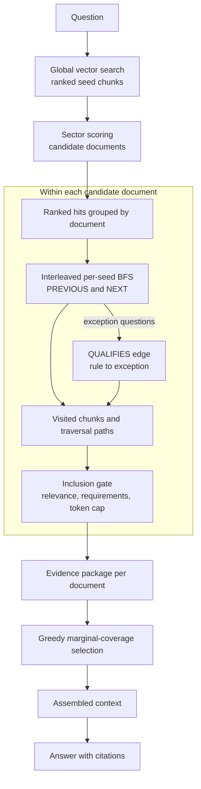

# Isthmus

Isthmus is an experimental document-search tool. It looks for useful passages
in a collection of files, checks nearby text for extra context, and can ask an
AI model to draft an answer with citations.

## Status

This is a research prototype, not a production-ready product. It can miss
important information, and citations do not guarantee that an answer is
correct.

## How retrieval works

Isthmus starts with a global vector search, expands evidence within candidate
documents, and then selects document-level evidence packages for the answer.



### Traversal is not inclusion

Each ranked hit seeds its own breadth-first traversal state. The states are
interleaved in a FIFO queue, with per-seed paths and directional limits plus
document-wide node and token caps. A visited chunk can help the search reach
useful nearby evidence without being included in the answer context. Seeds are
eligible for inclusion; other chunks must pass the similarity or
requirement-support checks. All included chunks are subject to the token cap.
By default, the similarity cutoff is 0.62 and each document package is limited
to 1,800 tokens.

The parser creates `QUALIFIES` relationships from a rule chunk to a nearby
exception or qualification chunk when its text or heading contains signals
such as “except”, “unless”, or “provided that”. Isthmus follows these edges
only for queries asking about exceptions. A qualifying target can be traversed
and included at similarity 0.42 or higher, below the ordinary 0.62 cutoff.

**Heuristic limitation:** `QUALIFIES` links are inferred from keywords and
nearby text, not semantically verified, so they can be false. Spot checks found
obvious false links in a deterministic sample of 40 predicted edges in the
Docugami audit. This assistant-reviewed sample is too small to estimate
precision and does not measure missed links.

### Multi-seed example

Suppose the question is, “Who qualifies for the travel allowance, and what
exceptions apply?” Global vector search returns two seed chunks in one policy
document: an eligibility rule and a related allowance section. Each seed gets
its own BFS state. The eligibility traversal may visit a low-similarity
definition as a bridge but leave it out of the evidence package, while
following a `QUALIFIES` edge to a relevant “unless ...” clause. Since the
question asks about exceptions, that clause can be included at the lower
0.42 threshold. The package records the seeds, visited paths, included chunks,
and requirement scores; it does not treat every visited chunk as answer
evidence.

### Selecting documents by marginal coverage

After expansion, Isthmus builds one evidence package per candidate document.
The default selector repeatedly chooses the package with the best combined
score: 55% marginal requirement coverage and 45% relevance. Marginal coverage
is the average improvement in query-requirement scores over the packages
already selected. This favors a relevant document that adds missing evidence
over another document repeating what is already covered. By default, selection
can include up to five documents; after the first pick, a package with no new
supported requirement is skipped when its marginal gain is below 0.05.

## What we learned from testing

We tested Isthmus on two public data sources. The results are early evidence,
not proof that Isthmus is better than standard search.

On the RepLiQA question set, we measured natural retrieval context and compared
answer quality across four methods. For the answer-quality comparison, each
method saw the same amount of text for a given question; GPT-4o-mini wrote and
scored the answers. Scores are averages from 64 answerable questions that
could be scored across every method. An unanswerable question is one whose
answer is not in the document.

### The context reduction

The marginal-coverage pipeline returned about half as much natural context and
selected about one document instead of 19. Retrieval metrics show the tradeoff:

| Metric | Standard search | Isthmus marginal |
|---|---:|---:|
| Mean context words | 1,505 | **724** |
| Mean documents | 18.98 | **1.02** |
| Gold-document hit | 91.8% | 80.8% |
| Passage words recovered | 86.2% | 81.5% |

Gold-document hit is measured on 73 answerable questions; passage-word recall
uses the 68 reference passages verified in their source documents.

Natural context words per query (bars are scaled to about 75 words):

```text
Standard search   ####################  1,505
Isthmus marginal  ##########              724
```

That is about 52% fewer context words, with an 11-point lower gold-document
hit rate and 4.7 points lower passage-word recall. The compact context is a
meaningful efficiency result worth investigating, not a free improvement in
retrieval quality.

In the separate answer-quality comparison, standard search and Isthmus
marginal coverage both averaged **3.30/4 correctness**. However, those answers
were generated from equal-sized contexts, clipped to the same word count per
question. This tests answer quality at controlled context size; it does not
measure generation-token or API-cost savings from the natural 724-word output.
That requires a separate end-to-end cost measurement using each method's
unclipped context.

### Answer quality at equal context sizes

| Method | Accuracy (0–4) | Completeness (0–4) | Supported by sources (0–4) | Correctly said “not in document” |
|---|---:|---:|---:|---:|
| Standard search | 3.30 | **3.45** | **2.89** | 8% |
| Add nearby passages | 3.00 | 3.14 | 2.59 | **21%** |
| Isthmus (fixed-target selection) | 3.30 | 3.38 | 2.56 | 12% |
| Isthmus (marginal-coverage selection) | 3.30 | 3.42 | 2.61 | 0% |

**The main finding:** marginal coverage returned about 52% less natural
context, while tying standard search on correctness in the equal-sized answer
test. The tradeoff was lower gold-document hit rate and source-support scores.
This is a promising compact-retrieval result, not proof that the natural
shorter context preserves answer quality or lowers generation cost. Marginal
coverage did not refuse any unanswerable question in this sample.

Scores range from 0 to 4, with higher being better. “Correctly said not in
document” is the share of unanswerable questions where the model did not guess.

This was a 100-question test, and the same AI model wrote and scored answers.
The results need more testing and human review before drawing broad
conclusions.

### Detailed numbers for technical readers

RepLiQA's `repliqa_4` split has 17,950 questions across 3,590 documents. The
full split was indexed into 73,095 chunks. In the 100-question sample, 73
questions were answerable; 68 of those had a reference passage verified in
the source document. The answerability label follows RepLiQA's rule that
`long_answer == "NA"` means unanswerable.

Each document was tagged with its RepLiQA topic as a sector, and all sectors
were kept in one shared search index. Search first looked across the full
index, then used sector scores to select candidate documents; this was not a
test of separate databases for each sector. The full Isthmus pipeline is
represented by the fixed-target and marginal-coverage rows below: both run
global retrieval, sector scoring, graph evidence expansion, and document
selection, with a different selection policy. “Sector + graph” is a component
comparison, not the full pipeline. In this sample, adding sector selection to
graph search did not change the retrieval scores.

“Gold-document hit” means retrieval found an expected source document.
“Exact passage found” and “passage words recovered” measure whether the
annotated answer passage appeared in retrieved text. Context size is the
average whitespace-delimited word and document count.

| Retrieval method | Gold-document hit | Exact passage found | Passage words recovered | Mean context words | Mean documents |
|---|---:|---:|---:|---:|---:|
| Standard search (top-k) | 91.8% | 82.4% | 86.2% | 1,505 | 18.98 |
| Fixed window | 91.8% | **85.3%** | **88.7%** | 3,639 | 18.98 |
| Adaptive graph | 84.9% | 82.4% | 83.0% | 2,746 | 4.98 |
| Sector + graph | 84.9% | 82.4% | 83.0% | 2,746 | 4.98 |
| Isthmus (fixed-target selection) | 84.9% | 83.8% | 84.5% | 1,928 | 3.00 |
| Isthmus (marginal-coverage selection) | 80.8% | 80.9% | 81.5% | **724** | **1.02** |

The separate Docugami test covered 171 questions about 77 PDFs. It matches
retrieved document names to expected names; it does not score answer
correctness.

| Retrieval method | Document recall | Document F1 | Mean context words |
|---|---:|---:|---:|
| Standard search (top-k) | **94.6%** | **47.4%** | 4,255 |
| Fixed document selection | 32.2% | 35.3% | 4,468 |
| Smallest useful context | 32.2% | 35.4% | 1,827 |

## Data sources and reports

- [Docugami KG-RAG-datasets](https://github.com/docugami/KG-RAG-datasets) —
  used for a document-search test on 77 PDFs and 171 questions.
- [ServiceNow RepLiQA](https://huggingface.co/datasets/ServiceNow/repliqa) —
  used for the question-answer test. We indexed the full `repliqa_4` split and
  reviewed a 100-question sample.


Reports:

- [RepLiQA evaluation summary](docs/repliqa-evaluation.md)
- [Full RepLiQA results (JSON)](evaluation/results/repliqa-4-gpt4o-mini-qa.json)
- [RepLiQA answers for human review (CSV)](evaluation/results/repliqa-4-gpt4o-mini-qa.human-review.csv)
- [Docugami evaluation report](docs/docugami-evaluation.md)
- [Docugami passage review](docs/docugami-passage-review.md)

## Code map

- `src/isthmus/` — retrieval pipeline, indexing, parsing, sector selection,
  graph expansion, answer generation, and user-facing interfaces.
- `src/isthmus/evaluation/` — reusable benchmark runners, datasets, and metrics.
- `evaluation/` — dataset-specific RepLiQA and Docugami evaluation scripts.
- `tests/` — automated checks for the package and evaluation tools.

Each Python file and function has a short docstring describing its purpose.

## Run locally

For developers, with Python 3.11 or newer:

```powershell
git clone https://github.com/gahanlal/isthmus-rag.git
cd isthmus-rag
py -3.11 -m venv .venv
.\.venv\Scripts\Activate.ps1
python -m pip install -r requirements.txt
python -m pytest
streamlit run frontend\streamlit_app.py
```

Add any provider keys to a local `.env` file and never commit them. AI provider
requests may incur charges and send document text to that provider. The local
HTTP API has no authentication; do not expose it publicly.

For implementation and evaluation details, see the files linked above and the
[`docs`](docs) folder.
